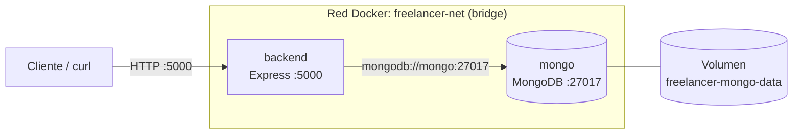
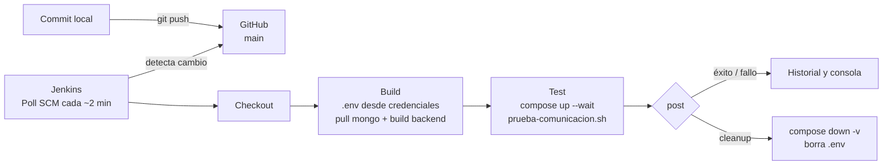

# Freelancer-App


Plataforma para publicar y contratar servicios freelance (React + Express + MongoDB).
Este repositorio contiene la **Entrega 1 del curso Integración Continua (Poligran)**:
dos contenedores Docker que se comunican entre sí.

| Contenedor | Servicio | Papel | Imagen |
|---|---|---|---|
| 1 | `backend` | API REST Express + Socket.IO | `node:20.18.0-alpine3.20` (Dockerfile propio) |
| 2 | `mongo` | Base de datos MongoDB con volumen persistente | `mongo:7.0.14` |

## Arquitectura



- El backend se conecta a Mongo usando el **nombre del servicio** (`mongo`), resuelto por el DNS interno de Docker. No se usa `localhost` ni IP fija.
- Mongo **no publica puertos al host**: solo es accesible desde la red `freelancer-net`.
- `depends_on` con `condition: service_healthy` hace que el backend arranque cuando Mongo ya responde.

## Estructura

```
Freelancer-App/
├── backend/                 # Contenedor 1
│   ├── Dockerfile
│   ├── .dockerignore
│   ├── package.json
│   └── src/
├── frontend/                # React (fuera del alcance de esta entrega)
├── scripts/
│   └── prueba-comunicacion.sh
├── .github/workflows/
│   └── docker-ci.yml        # Pipeline de CI
├── docker-compose.yml
├── .env.example             # Plantilla de variables (sin secretos)
└── README.md
```

## Requisitos

- Docker Engine 24+ y Docker Compose v2 (`docker compose`)
- Puerto **5000** libre en el host (configurable con `BACKEND_PORT` en `.env`)

## Levantar los contenedores

```bash
# 1. Clonar
git clone https://github.com/wrafael91/Freelancer-App.git
cd Freelancer-App

# 2. Crear el archivo de variables y cambiar las claves
cp .env.example .env

# 3. Construir y levantar
docker compose up -d --build

# 4. Verificar estado (ambos deben quedar "healthy")
docker compose ps
```

> Si la contraseña de Mongo tiene caracteres especiales (`@ : / ? #`), codifícalos en URL
> o usa solo letras y números, porque va dentro de `MONGODB_URI`.

## Probar la comunicación (ida y vuelta)

```bash
bash scripts/prueba-comunicacion.sh
```

El script:
1. Resuelve `mongo` por DNS desde dentro del contenedor `backend`.
2. Llama a `GET /api/health`, que hace ping a Mongo e informa el host usado (`mongo`).
3. **Escribe** un usuario con `POST /api/auth/register`.
4. **Lee** ese mismo usuario con `GET /api/auth/user`.
5. Confirma el documento directamente en el contenedor `mongo` con `mongosh`.

Prueba manual equivalente:

```bash
curl http://localhost:5000/api/health

curl -X POST http://localhost:5000/api/auth/register \
  -H "Content-Type: application/json" \
  -d '{"name":"Ana","email":"ana@test.com","password":"secreto123"}'
# -> {"token":"..."}

curl http://localhost:5000/api/auth/user -H "Authorization: Bearer <token>"
```

## Comandos útiles (evidencias)

```bash
docker build -t freelancer-app-backend:1.0.0 ./backend   # construir solo la imagen
docker compose ps                                         # estado de servicios
docker network inspect freelancer-net                     # contenedores en la red propia
docker compose logs -f backend                            # logs del backend
docker compose down                                       # apagar (conserva datos)
docker compose down -v                                    # apagar y borrar el volumen
```

## Integración continua

### Jenkins (Entrega 2)



- `jenkins/` contiene el `Dockerfile` (base `jenkins/jenkins:lts` + cliente de Docker y Compose),
  la lista de plugins y el compose que levanta Jenkins con el volumen `jenkins_home`
  y el socket de Docker montado.
- `Jenkinsfile` define el pipeline como código con las etapas **Checkout**, **Build** y **Test**
  y un bloque `post`. Los secretos (`MONGO_USER`, `MONGO_PASSWORD`, `JWT_SECRET`) son
  credenciales de Jenkins; el `.env` se genera en cada build y se borra al terminar.
- El disparo es por **Poll SCM**: Jenkins corre en `localhost`, así que GitHub no puede
  llamar a un webhook; Jenkins consulta el repositorio cada ~2 minutos.

```bash
docker compose down                                   # apaga el stack de desarrollo (usa los mismos nombres)
docker compose -f jenkins/docker-compose.yml up -d --build
# Contraseña inicial (en PowerShell; en Git Bash anteponer MSYS_NO_PATHCONV=1)
docker exec jenkins cat /var/jenkins_home/secrets/initialAdminPassword
```

### GitHub Actions

`.github/workflows/docker-ci.yml` se ejecuta en cada `push` y `pull request`:
genera un `.env` temporal con claves aleatorias, construye la imagen del backend,
levanta el compose esperando que ambos servicios estén `healthy` y ejecuta la
prueba de comunicación. Si algo falla, el check queda en rojo y se publican los logs.

## Variables de entorno

| Variable | Uso |
|---|---|
| `MONGO_USER` / `MONGO_PASSWORD` | Usuario root de Mongo (crea el contenedor 2 y los usa el 1) |
| `MONGO_DB` | Base de datos de la aplicación |
| `JWT_SECRET` | Firma de tokens del backend |
| `BACKEND_PORT` | Puerto del host para la API (por defecto 5000) |
| `FRONTEND_URL` | Origen permitido por CORS |
